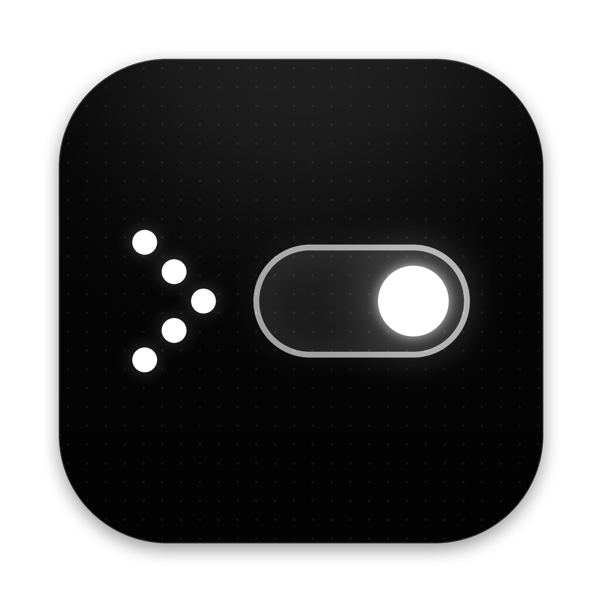

<p align="center">
  
</p>

<h1 align="center">SimpleToggle</h1>

<p align="center"><b>Turn any script into a managed menu bar switch on macOS.</b></p>

<p align="center">English | <a href="README.zh-CN.md">简体中文</a></p>

SimpleToggle renders each of your automation scripts as a first-class control in the macOS menu bar — a switch, a long-running process, or a button. A few comment lines at the top of the script describe it; SimpleToggle handles the process lifecycle, status polling, parameter UI, persistence, scenes, automations, shortcuts and a full local API for AI agents.

## Why

Everyday macOS automations — keep the display awake, flip a proxy, show hidden files, flush DNS — each traditionally need their own single-purpose utility crowding the menu bar. Script-to-menu-bar tools exist (SwiftBar, xbar, Hammerspoon), but their model is *script → printed output → display*: on/off semantics, process lifecycle and state persistence are hand-rolled per plugin.

SimpleToggle's model is *script → managed switch*. The contract is the product.

|  | SwiftBar / xbar | Hammerspoon | **SimpleToggle** |
|---|---|---|---|
| Mental model | print output → display | Lua automation framework | script → managed switch |
| On/off semantics | hand-rolled per plugin | hand-rolled in Lua | built in (toggle, daemon, button) |
| Process lifecycle | manual (pid files, pkill) | manual | process groups, SIGTERM → SIGKILL, orphan sweep |
| State persistence | manual | manual | restored at launch |
| Parameters | none | DIY | declarative: select, number with presets, text, key |
| Scenes, automations, shortcuts | — | DIY | built in |
| AI agents | — | — | local API, CLI, MCP server and skill, with approval |

## Features

- **Three switch types** — `toggle` (on / off / status), `daemon` (the app holds the process and stops it), and `action` (a button that runs once and shows progress and the result)
- **Panel** — a glass flyout under the menu bar icon: list or grid, comfortable or compact, groups, search, inline parameters, a scene bar
- **Workbench** — a code-first editor with syntax highlighting and contract diagnostics; an inspector that edits the header (name, icon, type, parameters, menu bar) in sync with the code; test buttons with live output; run history; a library of ready-made scripts
- **Scenes** — one click to set several switches; click again to put everything back the way it was
- **Automations** — run switches or scenes at a time, when joining a network, on power changes, when an app launches or quits, when a display connects, at login / wake / unlock, when a file changes, or on a shortcut; optional day and time windows; your manual changes win for 10 minutes; rules that flip a switch back and forth are paused automatically
- **Global shortcuts** — for switches, scenes, the panel and the workbench, with conflict detection
- **Activity** — every run with its source (manual, shortcut, scene, automation, AI, CLI…), duration, exit code and output; filter, export, clear
- **Menu bar** — three icon styles, an optional count or countdown, and per-switch status items
- **Appearance** — light, dark or system; five accent colors (default: ink, pure black and white); glass or solid panel
- **AI integration** — local API, CLI, MCP server and agent skill; per-capability permissions for AI; script changes from AI are shown as a diff and written only after you approve; one-click setup for Claude Code, Cursor and Codex
- **Deep links** — `simpletoggle://` for Shortcuts, Raycast and Alfred
- **Private by design** — everything stays on your Mac; the only network request checks for updates
- **English and Simplified Chinese**, switchable at runtime

## Install

```bash
brew install --cask hanlunwang/tap/simpletoggle
```

Or download the disk image from [Releases](https://github.com/HanlunWang/simple-toggle/releases). SimpleToggle is signed with a Developer ID, notarized, and updates itself (updates are verified with an Ed25519 signature before they are installed). Requires macOS 14 or later.

The Homebrew cask also links the `simpletoggle` command. On first launch a short walkthrough lets you pick switches from the library, choose a look and connect AI clients; every step can be skipped.

### Upgrading from OpenToggle 0.5

SimpleToggle was called OpenToggle up to 0.5. Quit OpenToggle, install SimpleToggle, and uninstall OpenToggle (`brew uninstall --cask opentoggle`). On first launch SimpleToggle copies your scripts from `~/.config/open-toggle/switches/` to `~/.config/simple-toggle/switches/` (the old folder is left alone) and imports which switches were on, parameter values, hidden switches and the language. Scripts that use `$OPENTOGGLE_BIN` keep working. Because the app has a new identity, grant Accessibility once more if you use key parameters, and reconnect your AI clients in Settings → AI & Integrations: the command is now `simpletoggle` and the MCP tools are `simpletoggle_*`. The `/v1` API is unchanged.

## Script contract

A switch is one executable script in `~/.config/simple-toggle/switches/` (changeable in Settings → Advanced), carrying metadata as `# <switch.*>` comments within its first 40 lines.

```bash
#!/bin/bash
# <switch.name> Keep Awake
# <switch.icon> lucide:coffee
# <switch.type> daemon
# <switch.description> Prevent sleep for a while
# <switch.param> key=mode type=select label=Mode default=d options="Display only=d|Display & system=dis"
# <switch.param> key=duration type=number label="Duration (min)" default=0 min=0 max=1440 presets="Unlimited=0|1 h=60|2 h=120"
# <switch.menubar> mode=add icon=lucide:coffee countdown=on
ARGS="-${SWITCH_MODE:-d}"
[ "${SWITCH_DURATION:-0}" -gt 0 ] && ARGS="$ARGS -t $((SWITCH_DURATION * 60))"
exec caffeinate $ARGS
```

| Directive | Required | Description |
|---|---|---|
| `<switch.name>` | yes | Display name |
| `<switch.icon>` | no | `lucide:<name>` (any icon from [lucide.dev](https://lucide.dev)), an emoji, or `sf:<symbol>` (mapped to Lucide) |
| `<switch.type>` | no | `toggle` (default), `daemon` or `action` |
| `<switch.description>` | no | One sentence for the library and tooltips |
| `<switch.param>` | no | One parameter per line; see below |
| `<switch.menubar>` | no | Menu bar presence while on; see below |

### How scripts are run

| Type | Invocation | Result |
|---|---|---|
| `toggle` | `<script> on`, `<script> off`, `<script> status` | `status` prints `on` or `off`; polled every 5 s while the panel is open, 30 s in the background. Non-zero from `status` → *unknown*; from `on`/`off` → *error* |
| `daemon` | `<script> run` | The app holds the process. Off sends SIGTERM to its process group (SIGKILL after 3 s). Exit 0 resets the switch; non-zero → *error*. Use `exec` |
| `action` | `<script>` (no arguments) | Exit 0 is success; the last line of output is shown as the result |

Every run gets `SIMPLETOGGLE_BIN` (the app's binary), `SIMPLETOGGLE_TRIGGER` (who started it) and the parameters as `SWITCH_<KEY>`; Homebrew's `bin` directories are added to `PATH`. Scripts without a shebang run with the default shell (Settings → Advanced).

### Parameters

| Attribute | Applies to | Description |
|---|---|---|
| `key` | all | Identifier; injected as `SWITCH_<KEY>` (uppercased, non-alphanumerics → `_`) |
| `type` | all | `select`, `number`, `text` or `key` |
| `label` | all | Display label |
| `default` | all | Initial value; for `select`, the first option when omitted |
| `options` | select | `label=value` pairs separated by `\|` |
| `presets` | number, text | Quick-pick buttons, same format |
| `min` / `max` | number | Inclusive bounds |
| `hint` | all | Placeholder or tooltip |

Quote values that contain spaces. Changing a parameter while a switch is on restarts it. `type=key` renders a key picker; scripts send the key with `"$SIMPLETOGGLE_BIN" press "$SWITCH_KEY"` (one-time Accessibility grant).

### Menu bar presence

`# <switch.menubar> mode=add icon=lucide:coffee countdown=on` — `mode=add` shows a dedicated status item while on, `mode=replace` swaps the main icon; `countdown=on` needs a number parameter with `key=duration` in minutes (0 = unlimited).

Every script submission — workbench, CLI, API or MCP — is linted against the contract: errors are rejected, warnings are shown with their line numbers.

## CLI

```
simpletoggle list                    # switches with state
simpletoggle on|off <id>             # turn a switch on or off
simpletoggle run <id>                # run an action and print its output
simpletoggle state <id>              # on | off | error | unknown
simpletoggle params <id>             # parameters and current values
simpletoggle set <id> k=v [...]      # set parameters (restarts a running switch)
simpletoggle enable|disable <id>     # show or hide in the panel
simpletoggle cat <id>                # print the script
simpletoggle add <file.sh>           # validate and install a new switch
simpletoggle put <id> <file.sh>      # validate and replace a script
simpletoggle rm <id>                 # delete (moves to the Trash)
simpletoggle scenes                  # list scenes
simpletoggle scene <name>            # activate a scene, or restore it when active
simpletoggle log [id] [--failed]     # recent runs
simpletoggle validate <file.sh>      # offline contract lint
simpletoggle press <keyspec>         # synthesize a key or mouse event
simpletoggle doctor                  # diagnose permissions and leftover processes
simpletoggle mcp                     # MCP server over stdio
```

`--json` gives machine-readable output. `<id>` is the script file name; `.sh` is optional.

## AI integration

- **One-click setup** — Settings → AI & Integrations connects Claude Code (`claude mcp add`), Cursor (`~/.cursor/mcp.json`) and Codex (`~/.codex/config.toml`), showing exactly what will be written first and backing up the file. Any other MCP client: add

  ```json
  { "mcpServers": { "simpletoggle": { "command": "/opt/homebrew/bin/simpletoggle", "args": ["mcp"] } } }
  ```

- **MCP tools** — list switches, set switches and parameters, run actions, read and write scripts (validated), activate scenes, read automations and run history, check pending changes.
- **Permissions** — choose what AI agents may do: read, flip switches, write scripts, delete scripts (off by default). Script changes from AI wait for your approval and are shown as a diff in the workbench; you get a notification. These limits guard against agent mistakes; they are not a security boundary, since any program on your Mac can edit the script files.
- **Skill** — [`skills/simpletoggle/`](skills/simpletoggle/SKILL.md) teaches agents the CLI and the authoring workflow (write → `validate` → `add`/`put` → verify). Install it from Settings → AI & Integrations.
- **Local API** — `127.0.0.1:43737`, loopback only; writes need the token from `~/.config/simple-toggle/api.json` (the CLI and MCP read it). `/v1` is compatible with OpenToggle 0.5; `/v2` adds actions, run history, server-sent events, scenes, automations and changes. Every request carries its source and shows up in Activity.

## Deep links

```
simpletoggle://toggle/keep-awake      simpletoggle://on/wifi      simpletoggle://off/wifi
simpletoggle://run/flush-dns          simpletoggle://scene/Focus
simpletoggle://panel                  simpletoggle://workbench/scenes
simpletoggle://settings/ai
```

## Privacy

No accounts, no telemetry. Scripts, state and logs stay on your Mac (`~/.config/simple-toggle/` and `~/Library/Application Support/SimpleToggle/`). The only network request checks GitHub Releases for updates. Permissions are requested only when needed: Accessibility for key parameters, Location only if you want Wi-Fi names shown in rules, Apple Events when a script controls another app, Notifications when the first one is sent.

## Building from source

SimpleToggle 2 is written in Go with [mygo](https://github.com/egoist/mygo) (native GPU UI, no web view). The engine, API, CLI and MCP server live in `internal/` and do not depend on the UI framework; `app/` is the UI.

```bash
go test ./...                    # unit and end-to-end tests
go tool mygo dev                 # run the app with live reload
go tool mygo build               # signed, notarized app and disk image (needs the signing identity in mygo.json)
```

The architecture and the record of each milestone are in [docs/v2-architecture.md](docs/v2-architecture.md). Its predecessor, OpenToggle 0.5 (Swift), lives on in the `main` branch history.

## License

[MIT](LICENSE)
