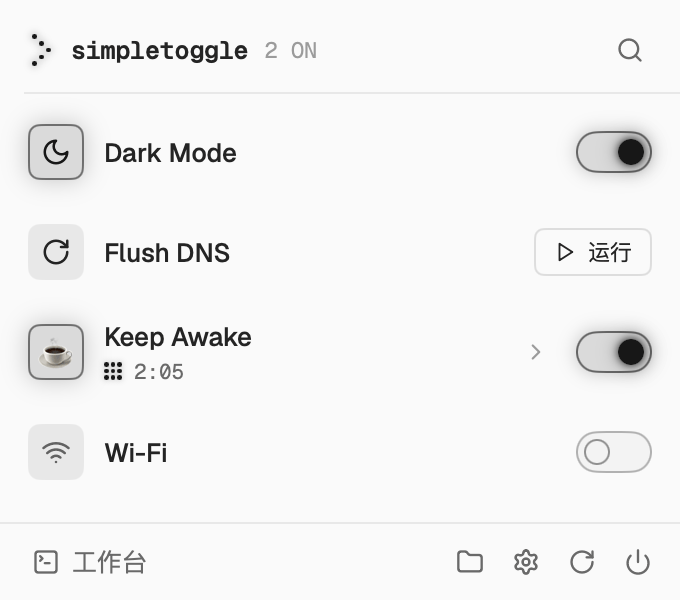
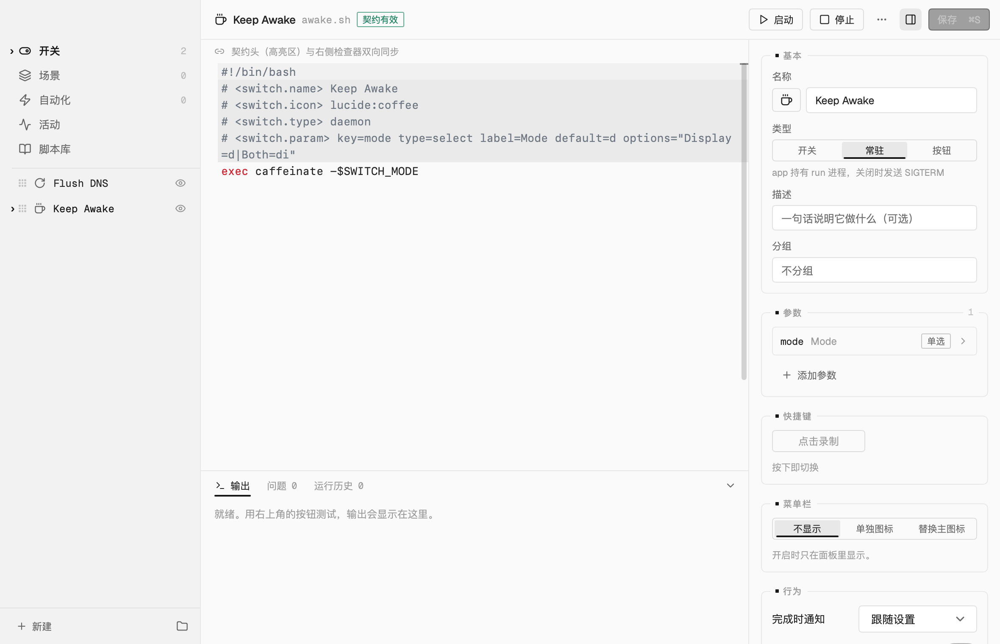
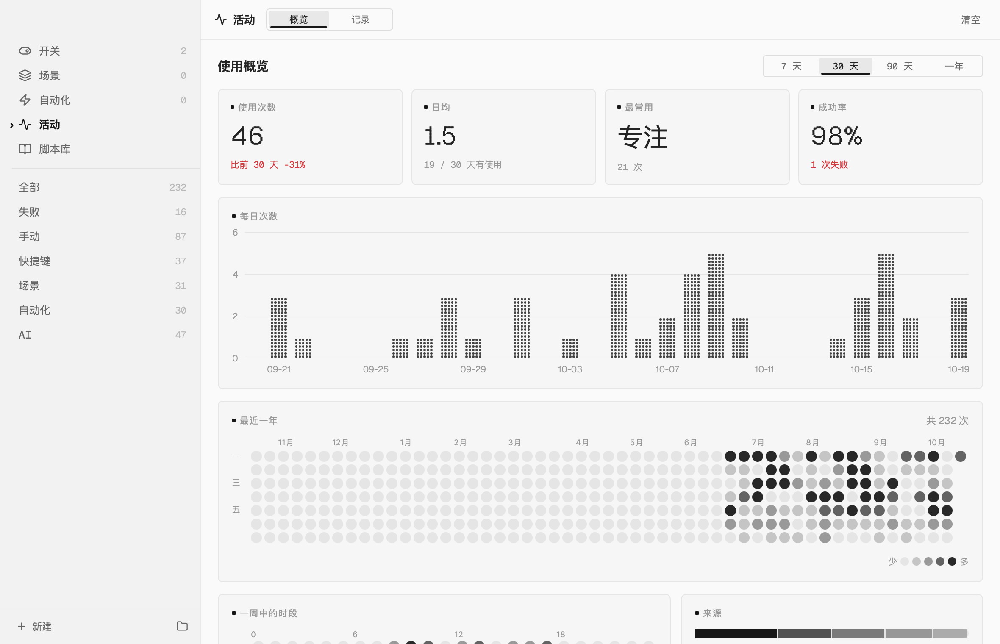

<p align="center">
  
</p>

<h1 align="center">SimpleToggle</h1>

<p align="center"><b>把任何脚本变成 macOS 菜单栏里受管理的开关。</b></p>

<p align="center"><a href="README.md">English</a> | 简体中文</p>

<p align="center">
  <picture>
    <source media="(prefers-color-scheme: dark)" srcset="docs/images/panel-dark.zh-CN.png">
    
  </picture>
</p>

SimpleToggle 把你的每个自动化脚本变成菜单栏里的一个控件：开关、常驻进程，或者按钮。脚本开头几行注释描述它，其余交给 SimpleToggle：进程生命周期、状态轮询、参数界面、状态保存、场景、自动化、快捷键，以及给 AI 用的完整本地接口。

## 为什么

日常的 macOS 自动化——让屏幕保持常亮、切换代理、显示隐藏文件、清空 DNS 缓存——传统做法是每样装一个单一用途的小工具，菜单栏越来越挤。也有把脚本放进菜单栏的工具（SwiftBar、xbar、Hammerspoon），但它们的模型是「脚本 → 打印输出 → 显示」：开关语义、进程管理和状态保存都要每个插件自己实现。

SimpleToggle 的模型是「脚本 → 受管理的开关」。契约本身就是产品。

|  | SwiftBar / xbar | Hammerspoon | **SimpleToggle** |
|---|---|---|---|
| 模型 | 打印输出 → 显示 | Lua 自动化框架 | 脚本 → 受管理的开关 |
| 开关语义 | 每个插件自己写 | 用 Lua 自己写 | 内置（开关、常驻、按钮） |
| 进程生命周期 | 手动（pid 文件、pkill） | 手动 | 进程组、SIGTERM → SIGKILL、清理遗留进程 |
| 状态保存 | 手动 | 手动 | 启动时自动恢复 |
| 参数 | 无 | 自己写 | 声明式：单选、带快捷值的数字、文本、按键 |
| 场景、自动化、快捷键 | — | 自己写 | 内置 |
| AI | — | — | 本地 API、命令行、MCP 服务器与 skill，改脚本需你确认 |

## 功能

- **三种类型**——`toggle`（on / off / status）、`daemon`（app 持有进程并负责结束它）、`action`（按一次运行一次，显示运行中与结果的按钮）
- **面板**——菜单栏图标下的玻璃面板：列表或网格、舒适或紧凑、分组、搜索、行内参数、场景栏
- **工作台**——代码优先的编辑器，语法高亮并标出契约问题；检查器编辑契约头（名称、图标、类型、参数、菜单栏），与代码双向同步；测试按钮与实时输出；运行历史；现成脚本的脚本库
- **场景**——一键设置多个开关，再点一次恢复原样
- **自动化**——在某个时间、连上某个网络、电源变化、某个 app 启动或退出、外接显示器连接、登录 / 唤醒 / 解锁、文件变化或按下快捷键时，运行开关或场景；可以限定星期与时间段；你手动改过的开关 10 分钟内不被规则改动；来回切换同一个开关的规则会被自动停用
- **全局快捷键**——开关、场景、面板和工作台都可以设，自动检测冲突
- **活动**——用量统计（每日次数、一整年的热力图、一周中的时段、来源、开关排行），以及每次运行的来源（手动、快捷键、场景、自动化、AI、命令行……）、耗时、退出码与输出；可筛选、导出、清空
- **菜单栏**——三种图标样式，可附带开启数量或倒计时，单个开关可以有自己的图标
- **外观**——浅色、深色或跟随系统；六套配色（默认「石墨」，另有信号红、暖纸、终端桃、磷光、冰蓝），唯一的信号色只标出开启与运行中的东西；玻璃或实色面板
- **AI 集成**——本地 API、命令行、MCP 服务器与 agent skill；可以分项限制 AI 能做什么；AI 改脚本以差异对比展示，你确认后才写入；一键接入 Claude Code、Cursor、Codex
- **深链接**——`simpletoggle://`，可以在快捷指令、Raycast、Alfred 里调用
- **隐私优先**——所有数据都在本机；唯一的网络请求是检查更新
- **简体中文与英文**，可以随时切换

<picture>
  <source media="(prefers-color-scheme: dark)" srcset="docs/images/workbench-dark.zh-CN.png">
  
</picture>

<picture>
  <source media="(prefers-color-scheme: dark)" srcset="docs/images/activity-dark.zh-CN.png">
  
</picture>

## 安装

```bash
brew install --cask hanlunwang/tap/simpletoggle
```

也可以在 [Releases](https://github.com/HanlunWang/simple-toggle/releases) 下载磁盘映像。SimpleToggle 使用 Developer ID 签名并经过公证，可以自动更新（更新包先校验 Ed25519 签名再安装）。需要 macOS 14 或更新版本。

Homebrew 安装时会同时链接 `simpletoggle` 命令。第一次启动有一个简短的引导：从脚本库挑选开关、选择外观、接入 AI 客户端，每一步都可以跳过。

### 从 OpenToggle 0.5 升级

SimpleToggle 在 0.5 及以前叫 OpenToggle。退出 OpenToggle，安装 SimpleToggle，再卸载 OpenToggle（`brew uninstall --cask opentoggle`）。第一次启动时，SimpleToggle 会把 `~/.config/open-toggle/switches/` 里的脚本复制到 `~/.config/simple-toggle/switches/`（旧目录保持不变），并导入哪些开关开着、参数值、隐藏的开关和语言设置。用到 `$OPENTOGGLE_BIN` 的脚本照常可用。因为 app 的身份变了，用到按键参数时需要再授予一次「辅助功能」权限；AI 客户端也要在「设置 → AI 与集成」里重新接入：命令改为 `simpletoggle`，MCP 工具改为 `simpletoggle_*`。`/v1` API 不变。

## 脚本契约

一个开关就是 `~/.config/simple-toggle/switches/`（可以在「设置 → 高级」里更改）下的一个可执行脚本，前 40 行里用 `# <switch.*>` 注释写元数据。

```bash
#!/bin/bash
# <switch.name> Keep Awake
# <switch.icon> lucide:coffee
# <switch.type> daemon
# <switch.description> 阻止休眠一段时间
# <switch.param> key=mode type=select label=模式 default=d options="仅屏幕=d|屏幕与系统=dis"
# <switch.param> key=duration type=number label="时长（分钟）" default=0 min=0 max=1440 presets="不限=0|1 小时=60|2 小时=120"
# <switch.menubar> mode=add icon=lucide:coffee countdown=on
ARGS="-${SWITCH_MODE:-d}"
[ "${SWITCH_DURATION:-0}" -gt 0 ] && ARGS="$ARGS -t $((SWITCH_DURATION * 60))"
exec caffeinate $ARGS
```

| 指令 | 必需 | 说明 |
|---|---|---|
| `<switch.name>` | 是 | 显示名称 |
| `<switch.icon>` | 否 | `lucide:<名称>`（[lucide.dev](https://lucide.dev) 上的任意图标）、emoji，或 `sf:<符号名>`（映射为 Lucide） |
| `<switch.type>` | 否 | `toggle`（默认）、`daemon` 或 `action` |
| `<switch.description>` | 否 | 一句话说明，显示在脚本库与悬浮提示里 |
| `<switch.param>` | 否 | 每行一个参数，见下文 |
| `<switch.menubar>` | 否 | 开启时在菜单栏的显示方式，见下文 |

### 脚本怎么被执行

| 类型 | 调用方式 | 结果 |
|---|---|---|
| `toggle` | `<脚本> on`、`<脚本> off`、`<脚本> status` | `status` 输出 `on` 或 `off`；面板打开时每 5 秒检查一次，后台每 30 秒。`status` 非零退出 → 未知；`on`/`off` 非零退出 → 出错 |
| `daemon` | `<脚本> run` | app 持有进程。关闭时向它的进程组发 SIGTERM（3 秒后 SIGKILL）。退出码 0 表示自然结束，开关归位；非零 → 出错。请用 `exec` |
| `action` | `<脚本>`（不带参数） | 退出码 0 表示成功；输出的最后一行显示为结果 |

每次执行都会注入 `SIMPLETOGGLE_BIN`（app 的二进制路径）、`SIMPLETOGGLE_TRIGGER`（由谁触发）以及参数 `SWITCH_<KEY>`；`PATH` 会补上 Homebrew 的 `bin` 目录。没有 shebang 的脚本用默认 shell 执行（「设置 → 高级」）。

### 参数

| 属性 | 适用于 | 说明 |
|---|---|---|
| `key` | 全部 | 标识，注入为 `SWITCH_<KEY>`（转大写，非字母数字变成 `_`） |
| `type` | 全部 | `select`、`number`、`text` 或 `key` |
| `label` | 全部 | 显示标签 |
| `default` | 全部 | 初始值；`select` 不写时取第一个选项 |
| `options` | select | 用 `\|` 分隔的 `标签=值` |
| `presets` | number、text | 快捷值按钮，格式相同 |
| `min` / `max` | number | 闭区间 |
| `hint` | 全部 | 占位文字或提示 |

含空格的值要加引号。开关开着时改参数会用新值重启。`type=key` 显示按键选择器；脚本用 `"$SIMPLETOGGLE_BIN" press "$SWITCH_KEY"` 发送按键（需要一次性授予「辅助功能」权限）。

### 菜单栏显示

`# <switch.menubar> mode=add icon=lucide:coffee countdown=on`——`mode=add` 开启时多显示一个图标，`mode=replace` 临时替换主图标；`countdown=on` 需要一个 `key=duration` 的数字参数（分钟，0 表示不限）。

所有脚本提交——工作台、命令行、API、MCP——都会按契约检查：错误拒收，警告连同行号一起显示。

## 命令行

```
simpletoggle list                    # 开关与状态
simpletoggle on|off <id>             # 打开或关闭
simpletoggle run <id>                # 运行按钮并打印输出
simpletoggle state <id>              # on | off | error | unknown
simpletoggle params <id>             # 参数与当前值
simpletoggle set <id> k=v [...]      # 修改参数（开着的开关会重启）
simpletoggle enable|disable <id>     # 在面板中显示或隐藏
simpletoggle cat <id>                # 打印脚本
simpletoggle add <file.sh>           # 检查并安装新开关
simpletoggle put <id> <file.sh>      # 检查并替换脚本
simpletoggle rm <id>                 # 删除（移到废纸篓）
simpletoggle scenes                  # 列出场景
simpletoggle scene <名称>            # 激活场景，激活中时恢复（--activate / --restore 强制其一）
simpletoggle log [id] [--failed] [--limit N]   # 最近的运行记录
simpletoggle validate <file.sh>      # 离线检查契约
simpletoggle press <按键>            # 模拟按键或鼠标
simpletoggle doctor                  # 诊断权限与遗留进程
simpletoggle mcp                     # stdio 上的 MCP 服务器
simpletoggle version
```

加 `--json` 输出机器可读的结果。`<id>` 是脚本文件名，`.sh` 可以省略。

## AI 集成

- **一键接入**——「设置 → AI 与集成」可以接入 Claude Code（`claude mcp add`）、Cursor（`~/.cursor/mcp.json`）和 Codex（`~/.codex/config.toml`），写入前先展示具体内容，并备份原文件。其他 MCP 客户端加入：

  ```json
  { "mcpServers": { "simpletoggle": { "command": "/opt/homebrew/bin/simpletoggle", "args": ["mcp"] } } }
  ```

- **MCP 工具**——列出开关、开关与改参数、运行按钮、读写脚本（会检查契约）、激活场景、读取自动化与运行记录、查询待确认的修改。
- **权限**——决定 AI 能做什么：读取、开关、改脚本、删脚本（默认不允许）。AI 改脚本会先等你确认：工作台用差异对比展示，同时发通知。这些限制用来防止 agent 误操作，不是安全边界——本机上的任何程序本来就能直接修改脚本文件。
- **Skill**——[`skills/simpletoggle/`](skills/simpletoggle/SKILL.md) 教 AI 使用命令行和编写流程（写 → `validate` → `add`/`put` → 验证）。在「设置 → AI 与集成」里安装。
- **本地 API**——`127.0.0.1:43737`，只监听本机回环；除 ping 与 validate 外，所有请求都需要 `~/.config/simple-toggle/api.json` 里的令牌（命令行与 MCP 会自动读取）。`/v1` 与 OpenToggle 0.5 兼容；`/v2` 新增按钮、运行记录、事件流（SSE）、场景、自动化与待确认修改。每个请求都带来源，并记录在「活动」里。

## 深链接

```
simpletoggle://toggle/keep-awake      simpletoggle://on/wifi      simpletoggle://off/wifi
simpletoggle://run/flush-dns          simpletoggle://scene/专注
simpletoggle://panel                  simpletoggle://workbench/scenes
simpletoggle://settings/ai
```

## 隐私

没有账号，没有遥测。脚本、状态和日志都保存在本机（`~/.config/simple-toggle/` 与 `~/Library/Application Support/SimpleToggle/`）。唯一的网络请求是到 GitHub Releases 检查更新。权限只在需要时才请求：按键参数需要「辅助功能」，想在规则里显示 Wi-Fi 名称时才需要「定位」，脚本控制其他 app 时由 macOS 询问「自动化」，第一次发通知时询问「通知」。

## 从源码构建

SimpleToggle 2 用 Go 和 [mygo](https://github.com/egoist/mygo) 编写（原生 GPU 界面，不用 WebView）。引擎、API、命令行与 MCP 服务器在 `internal/`，不依赖界面框架；`app/` 是界面。

```bash
go test ./...                    # 单元测试与端到端测试
go tool mygo dev                 # 运行 app，修改后自动重载
go tool mygo build               # 签名、公证的 app 与磁盘映像（需要 mygo.json 里的签名身份）
```

各部分如何组合在一起，见 [docs/architecture.md](docs/architecture.md)（英文）。它的前身 OpenToggle 0.5（Swift）在标签 [`v0.5.1`](https://github.com/HanlunWang/simple-toggle/tree/v0.5.1)。

欢迎提交问题与 PR；CI 会运行 gofmt、`go vet`、全部测试，并按契约检查每个预置脚本。安全问题请按 [SECURITY.md](SECURITY.md) 私下报告。

## 许可证

[MIT](LICENSE)。SimpleToggle 内置 [Geist](https://vercel.com/font) 字体（SIL Open Font License 1.1，[`app/fonts/OFL.txt`](app/fonts/OFL.txt)）与 [Lucide](https://lucide.dev) 图标（ISC，[`app/icons/LUCIDE_LICENSE`](app/icons/LUCIDE_LICENSE)），基于 [mygo](https://github.com/egoist/mygo) 与 [MCP Go SDK](https://github.com/modelcontextprotocol/go-sdk) 构建。
